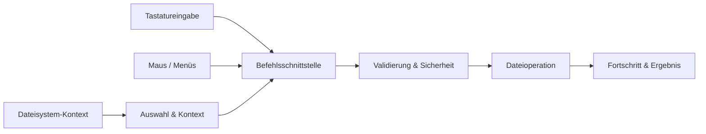

# QuickFile
### Kontextbezogene Dateiaktionen für den Desktop

**Desktop-Produktivität** · **Kontextbezogene Workflows** · **Interaction Engineering**

[English](./README.md) · [Deutsch](./README.de.md) · [Türkçe](./README.tr.md)

---

## Überblick

**QuickFile** untersucht einen direkteren Umgang mit Dateien und Ordnern. Statt für alltägliche Aktionen mehrere Fenster zu durchlaufen, stehen das ausgewählte Element, sein Kontext und die gerade relevanten Befehle im Mittelpunkt.

Das Produkt kombiniert die Auffindbarkeit kontextbezogener Menüs mit schnellen Tastaturabläufen und kompakten Desktop-Oberflächen. Es ergänzt den Dateimanager des Betriebssystems, statt ihn zu ersetzen.

## Interaktionsmodell

| Oberfläche | Aufgabe |
|---|---|
| **Kontextaktionen** | Passende Befehle für Dateien, Ordner und den aktuellen Kontext anbieten |
| **Schnellaktionsbereich** | Häufige Operationen kompakt zugänglich machen |
| **Radiale und verschachtelte Menüs** | Verwandte Befehle verständlich strukturieren |
| **Tastaturinteraktion** | Schnelle Navigation und Befehlsausführung unterstützen |
| **Dateiinspektor** | Metadaten und verfügbare Aktionen zusammen darstellen |
| **Aktionsfeedback** | Fortschritt, Ergebnis, Fehler und notwendige Bestätigung anzeigen |

Unterschiedliche Eingabemethoden sollen dieselbe Befehlssemantik verwenden: Ein Tastaturkürzel und ein Kontextmenü dürfen die Bedeutung einer Aktion nicht verändern.

## Konzeptionelle Architektur

Das Diagramm beschreibt die Interaktionsarchitektur und nicht notwendigerweise einzelne Implementierungsmodule.

## Technische Schwerpunkte

**Kontextauflösung.** Aktionen müssen sich für Dateien, Ordner, Mehrfachauswahl und inzwischen veränderte Dateisystemeinträge vorhersehbar verhalten.

**Sichere Operationen.** Destruktive Aktionen erfordern klare Rückmeldung und angemessene Bestätigung. Berechtigungsfehler, Namenskonflikte und teilweise abgeschlossene Vorgänge müssen verständlich bleiben.

**Reaktionsfähigkeit.** Teure oder asynchrone Dateioperationen dürfen die Oberfläche nicht blockieren; laufende, erfolgreiche und fehlgeschlagene Aktionen müssen unterscheidbar sein.

**Konsistente Eingabe.** Maus, Tastatur und Menüs benötigen ein gemeinsames Befehlsmodell, klares Fokusverhalten und zugängliche Zustände.

**Desktop-Integration.** Dateisystemrechte und betriebssystemspezifische Konventionen bilden Plattformgrenzen, die explizit berücksichtigt werden müssen.

## Designansatz

QuickFile setzt auf eine kompakte, informationsdichte Desktop-Gestaltung mit präziser Hierarchie, zurückhaltender Bewegung, klaren Fokuszuständen und kontextbezogener Darstellung.

Die zentrale Frage lautet: **Wie viele Schritte lassen sich aus alltäglichen Dateioperationen entfernen, ohne Kontrolle oder Verständlichkeit zu verlieren?**

---

**QuickFile** · `Desktop Engineering` · `File Workflows` · `Productivity` · `Interaction Design`

Entwickelt von [Taha Kubilay](https://github.com/tahakubilay)

