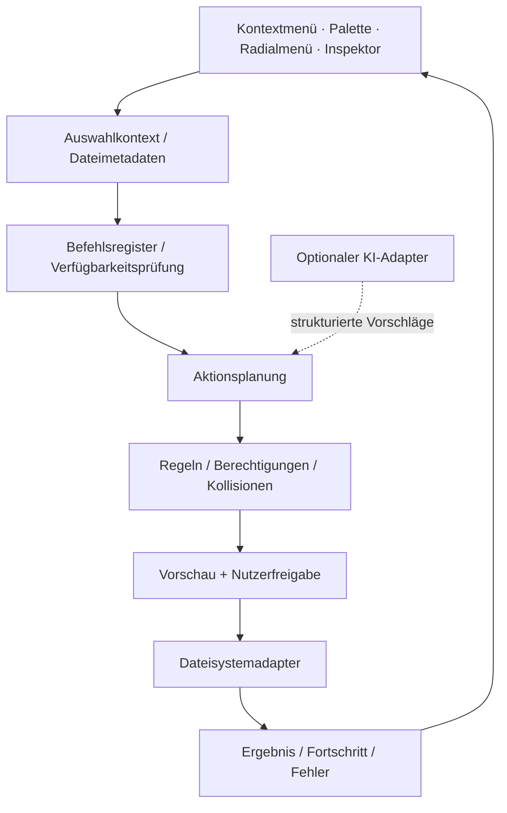

<div align="center">

# QuickFile
### Kontextbezogene Desktop-Arbeitsoberfläche für intelligente Dateioperationen


**Kontextbefehle** · **KI-gestützte Dateiabläufe** · **Desktop Interaction Engineering**

[English](./README.md) · [**Deutsch**](./README.de.md) · [Türkçe](./README.tr.md)

</div>

---

## Konzept

**QuickFile** bringt Dateioperationen direkt an den Ort der Aufmerksamkeit. Dateisystemkontext, aktionsorientierte Oberfläche und optionale KI-Unterstützung bilden einen gemeinsamen Desktop-Arbeitsablauf.

Klassische Dateimanager sind auf Navigation ausgelegt, Launcher auf Befehle und KI-Tools häufig auf Chats. QuickFile untersucht die Verbindung: **Element auswählen → Kontext erfassen → Aktion festlegen → Vorschau prüfen → kontrolliert ausführen**.


## Interaktionsflächen

| Oberfläche | Interaktionsmodell | Technische Anforderung |
|---|---|---|
| **Kontextmenü** | Dateityp- und auswahlabhängige Befehle | Filterung, Verfügbarkeit, Berechtigungen |
| **Schnellaktionspalette** | Befehle suchen und ohne großes Fenster ausführen | Tastaturfokus, Ranking, Shortcuts |
| **Radiale Aktionen** | Häufige Operationen räumlich gruppieren | Zielgrößen, Abbruch, Bedienbarkeit |
| **Verschachtelte Menüs** | Komplexe Befehle schrittweise erschließen | Navigation, Zustandsübergänge |
| **Dateiinspektor** | Pfad, Größe, Zeitstempel, Eigenschaften und Aktionen | Asynchrone Metadaten, veraltete Auswahl |
| **Stapelverarbeitung** | Einen Befehl auf mehrere Dateien anwenden | Konflikte, Teilerfolge, Einzelergebnisse |
| **Vorschau / Bestätigung** | Geplante Änderungen vor Ausführung prüfen | Sicherheit, Änderungsvergleich |
| **Aktivität / Wiederherstellung** | Laufende und abgeschlossene Vorgänge erklären | Fortschritt, Abbruch, Wiederholung |

Die verschiedenen Oberflächen sollen dieselbe Befehlssemantik verwenden. Ein Tastaturkürzel und ein Kontextmenü dürfen unterschiedliche Einstiegspunkte, aber nicht unterschiedliche Dateisystemregeln besitzen.

### Kontextbezogene Befehlsauflösung

Die Aktion **Umbenennen** benötigt je nach Auswahl unterschiedliche Vorbedingungen:

- Eine einzelne beschreibbare Datei kann direkt umbenannt werden.
- Mehrere Dateien benötigen einen Batch-Plan inklusive Kollisionsprüfung.
- Schreibgeschützte Ordner dürfen nicht als regulär editierbar erscheinen.
- Zwischen Vorschau und Ausführung verschwundene Einträge müssen erneut geprüft werden.
- KI-generierte Dateinamen dürfen Zeichen-, Pfad- und Überschreibungsregeln nicht umgehen.

Die Oberfläche zeigt den Zustand eines **Befehlsvertrags**, erteilt aber selbst keine Dateisystemberechtigung.

## KI-gestützte Dateiverarbeitung

Die KI-Schicht wird als **Vorschlagsmaschine** betrachtet, nicht als Instanz, die selbstständig das Dateisystem verändert. Folgende Fähigkeiten gehören zum Interaktionsmodell; ihre konkrete Verfügbarkeit hängt von Dateiadaptern, Modellkonfiguration und Validierung ab.

| Fähigkeit | Anwendung | Sicherheitsgrenze |
|---|---|---|
| **Semantische Dateisuche** | Inhalte und Bedeutung statt nur Dateinamen suchen | Definierter Indexbereich, nachvollziehbare Treffer |
| **Zusammenfassungen** | Ausgewählte Dokumente oder Dateigruppen zusammenfassen | Dateiformat- und Größenlimits |
| **Intelligentes Umbenennen** | Namen aus Inhalt und Metadaten vorschlagen | Alte und neue Pfade einzeln prüfen |
| **Kategorisierung** | Rechnungen, Bilder, Dokumente und Projektdateien gruppieren | Konfidenz und manuelle Korrektur |
| **Stapelorganisation** | Natürliche Sprache in Kopier-/Verschiebe-/Umbenennungspläne übersetzen | Simulation, Kollisionsprüfung, Freigabe |
| **Metadatenextraktion** | Strukturierte Tags und Suchattribute ableiten | Herkunft und Extraktionsfehler |
| **Workflow-Vorschläge** | Passende Aktionen im aktuellen Kontext anbieten | Nachvollziehbare, optionale Ausführung |

### Beispiel: natürlicher Sprachbefehl

> „Sortiere diese PDFs nach Jahr, gib ihnen einheitliche Namen und behalte die Originale.“

Daraus entsteht ein **prüfbarer Aktionsplan** mit erkanntem Jahr, Zielordner, ursprünglichem und vorgeschlagenem Dateipfad, Unklarheiten sowie Kopier- oder Verschiebesemantik. Erst nach der Prüfung wird geschrieben. Fehlende Daten und Namenskonflikte dürfen nicht stillschweigend geraten werden.


**Datenschutzgrenze:** Lokale Metadatenverarbeitung und externe Modellinferenz sind nicht gleichwertig. Eine sichere Architektur unterscheidet lokale Verarbeitung, optionale externe Anbieter und ausdrückliche Zustimmung. Das Auswählen eines KI-Befehls ist keine pauschale Erlaubnis, Dokumentinhalte an fremde Dienste zu übermitteln.

## Technische Architektur



Das Diagramm beschreibt **Architekturgrenzen**, nicht die Behauptung, dass alle Adapter bereits als ausführbare Module veröffentlicht wurden.

### Beispiel eines Befehlsvertrags

```ts
type FileActionPlan = {
  operation: "copy" | "move" | "rename" | "delete";
  targets: Array<{
    source: string;
    destination?: string;
    expectedFingerprint?: string;
  }>;
  preconditions: string[];
  collisions: Array<{ path: string; reason: string }>;
  confirmationRequired: boolean;
};
```

Die Schnittstelle ist **illustrativ**, keine Zusage einer veröffentlichten API. Sie trennt UI- bzw. KI-Vorschläge von validierten Dateioperationen.

## Robustheit und Fehlerfälle

| Risiko | Technische Maßnahme |
|---|---|
| **Time-of-check / time-of-use** | Auswahl und Ziel unmittelbar vor Ausführung erneut prüfen |
| **Namenskollisionen** | Definierte Strategien: überspringen, umbenennen, bewusst ersetzen |
| **Teilerfolg bei Batch-Aktionen** | Einzelne Resultate protokollieren statt künstliche Atomizität zu behaupten |
| **Abbruch** | Unterbrechbare Vorgänge und Wiederherstellungsgrenzen unterscheiden |
| **Berechtigungen / Dateisperren** | Echte Fehler anzeigen, keine scheinbaren Erfolge |
| **Pfad- und Link-Sicherheit** | Symbolische Links, Traversal und geschützte Ziele berücksichtigen |
| **Unzuverlässige KI-Ausgabe** | Strukturierte Befehle parsen, zulässige Aktionen prüfen, Freigabe verlangen |
| **Lange Operationen** | Fortschritt ohne blockierende Oberfläche darstellen |

Undo-Garantien müssen zur Operation passen: Eine reversible Umbenennung und eine endgültige Löschung besitzen nicht denselben Wiederherstellungsweg.

## Desktop-Designsystem

QuickFile setzt auf hohe Informationsdichte, präzise Hierarchie, reduzierte Bewegung und eindeutige Zustände für Auswahl, Hover, Tastaturfokus, Deaktivierung, Wartezeiten, destruktive Aktionen und Erfolg.

Zu den Interaktionsbausteinen gehören Aktionszeilen, Suchpaletten, verschachtelte Menüs, Inspektoren, Bestätigungsdialoge, Vorschauen, Fortschrittsanzeigen und Aktivitäten.

**Projektkontext:** QuickFile ist als Open-Source-Desktop-Produkt ausgerichtet. Dieses Repository beschreibt das Produkt- und Interaktionsmodell; Diagramme und Codebeispiele sind keine Leistungsnachweise oder Behauptungen über den Implementierungsstand jeder Funktion.

---

<div align="center">

Entwickelt von [Taha Kubilay](https://github.com/tahakubilay) · [English](./README.md) · [Türkçe](./README.tr.md)

</div>
