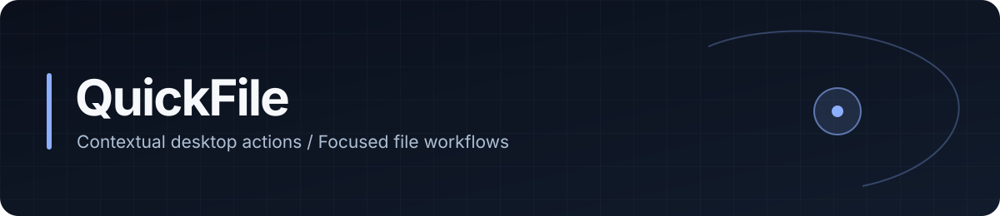
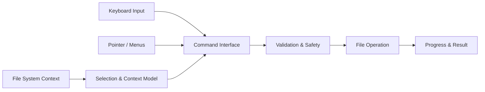

# QuickFile
### Context-aware file actions, designed for the desktop

**Desktop Productivity** · **Contextual Workflows** · **Interaction Engineering**

[English](./README.md) · [Deutsch](./README.de.md) · [Türkçe](./README.tr.md)

---

## Overview

**QuickFile** explores a more direct way to interact with files and folders. Instead of navigating multiple windows for routine operations, the application centers on the selected item, its context, and the actions that matter at that moment.

The product combines the discoverability of contextual menus with the speed of keyboard-first tools and compact desktop surfaces. It is designed to complement the operating system's file manager, not replace it.

## Interaction Model

| Surface | Responsibility |
|---|---|
| **Contextual actions** | Present operations relevant to a selected file, directory or active context |
| **Quick-action panel** | Provide a compact entry point for frequent operations |
| **Radial and nested menus** | Organize related actions without long, flat command lists |
| **Keyboard interaction** | Support rapid navigation and command execution |
| **File inspector** | Present useful metadata and available operations together |
| **Action feedback** | Communicate progress, results, errors and confirmation requirements |

Different input methods should resolve to the same underlying action semantics: selecting an operation with a keyboard shortcut or a contextual menu should not change what that operation does.

## Conceptual Architecture

This diagram describes the interaction architecture; it does not imply that every component is exposed as a separate implementation module.

## Engineering Considerations

**Context resolution.** Actions need predictable behavior across files, folders, multiple selections and missing or changing filesystem entries.

**Operation safety.** Destructive actions require explicit feedback and appropriate confirmation. Permission failures, collisions and partial operations should remain understandable.

**Responsiveness.** File operations can be asynchronous or expensive; the interface should preserve input responsiveness and distinguish pending, successful and failed operations.

**Input consistency.** Pointer, keyboard and menu-based interactions should share an action model, focus behavior and accessible states.

**Desktop integration.** Filesystem permissions, OS-specific conventions and integration points should be handled as platform boundaries rather than assumed to behave identically everywhere.

## Design Direction

QuickFile follows a compact, information-dense desktop design language: precise hierarchy, restrained motion, clear focus states and contextual presentation. Visual polish serves the workflow rather than replacing it.

The project's central question is straightforward: **how much interaction can be removed from everyday file operations without sacrificing control or clarity?**

---

**QuickFile** · `Desktop Engineering` · `File Workflows` · `Productivity` · `Interaction Design`

Created by [Taha Kubilay](https://github.com/tahakubilay)

