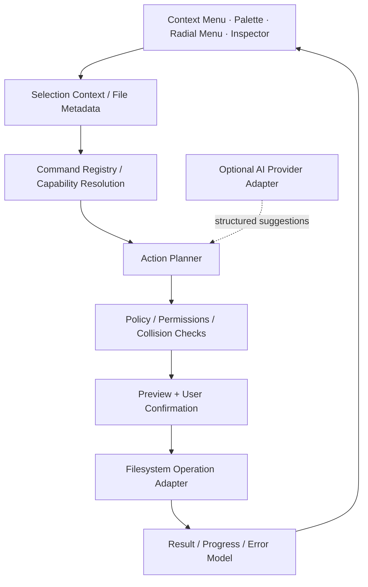

<div align="center">

# QuickFile
### A context-aware desktop workspace for intelligent file operations


**Contextual Commands** · **AI-Assisted File Workflows** · **Desktop Interaction Engineering**

[**English**](./README.md) · [Deutsch](./README.de.md) · [Türkçe](./README.tr.md)

</div>

---

## The Idea

**QuickFile** brings file operations closer to the user's point of attention. It combines the filesystem context, an action-oriented command surface and an optional AI assistance layer into one desktop workflow.

Traditional file managers are optimized for navigation; launchers are optimized for commands; AI tools are often optimized for chat. QuickFile explores the intersection: **select something → understand its context → decide what to do → preview → execute with clear feedback**.

The project is organized around desktop-native interaction patterns rather than forcing every operation into a separate window.


## Interaction Surfaces

| Surface | Interaction model | Engineering concern |
|:---|:---|:---|
| **Context menu** | File- and selection-specific actions within the active workflow | Filtering, action availability, permission states |
| **Quick action palette** | Search, navigate and execute commands without opening a full workspace | Keyboard focus, matching, ranking, shortcut discovery |
| **Radial actions** | Spatial grouping for frequently used operations | Pointer movement, target size, cancellation, accessibility |
| **Nested action menus** | Progressive disclosure of complex workflows | State transitions, breadcrumbs, hierarchy |
| **Inspector panel** | File type, path, size, timestamps, operation context and properties | Async metadata, stale-selection detection |
| **Batch action workspace** | One command across multiple selected files | Per-item outcomes, conflicts, partial success |
| **Preview / confirmation** | Inspect the computed operation before committing changes | Destructive-operation safety, diff/review |
| **Activity and recovery** | Explain running, failed and completed actions | Progress, cancellation, retry and recoverability |

One action can be exposed through multiple surfaces without implementing different filesystem semantics for each menu or shortcut.

### Example: context-sensitive action resolution

A command like **Rename** has different prerequisites and failure modes depending on the selection:

- A single writable file can expose a direct rename operation.
- Multiple files require a batch rename plan and collision analysis.
- A read-only directory cannot offer a write action as though it were valid.
- A selection that disappears between preview and execution must be revalidated.
- A filename suggestion must not bypass illegal-character, reserved-name or overwrite checks.

The UI is a projection of an underlying **command contract**, not the source of permission to modify files.

## AI-Assisted Workflows

AI is most useful here as a **proposal engine**, not an authority that silently changes the filesystem. The interaction design covers the following capabilities; individual operations depend on suitable file adapters, model configuration and validation.

| Capability | User-facing behavior | Required safeguard |
|:---|:---|:---|
| **Semantic file discovery** | Search by intent or meaning instead of memorizing a filename | Clear indexing boundary; no invented matches |
| **Content summarization** | Summarize selected documents or groups of files | File-type support, size limits, sensitive-data handling |
| **Intelligent renaming** | Suggest consistent names based on content and metadata | Preview every proposed old → new path |
| **File categorization** | Group invoices, images, documents or project files by inferred type | Confidence visibility and manual override |
| **Bulk organization** | Convert natural-language requests into move/copy/rename proposals | Dry run, collision detection and confirmation |
| **Metadata extraction** | Derive structured tags and searchable attributes | Source provenance and extraction error handling |
| **Workflow suggestions** | Surface useful actions for a selected set or repeated pattern | Predictable opt-in execution |

#### Example: an instruction becomes a reviewable operation

> "Group the PDFs by year, give them consistent names, and leave the originals unchanged."

That request should produce a **proposed action plan**: detected year, suggested destination, original path, new path, ambiguity indicator and copy-vs-move semantics. The user reviews the plan before the filesystem changes. Ambiguous dates, unreadable documents and naming collisions remain visible instead of being silently guessed.


### Privacy boundary

Local metadata inspection and externally hosted model inference have fundamentally different privacy implications. A safe adapter architecture distinguishes **local-only processing**, **optional remote inference** and **explicit user approval**. Sending arbitrary document contents to a remote model must never be assumed to be acceptable simply because an AI command was selected.

## Architecture



The diagram defines the **product's architectural boundaries**. It does not claim that every adapter or AI operation is already present as a released implementation.

### Example command contract

```ts
type FileActionPlan = {
  operation: "copy" | "move" | "rename" | "delete";
  targets: Array<{
    source: string;
    destination?: string;
    expectedFingerprint?: string;
  }>;
  preconditions: string[];
  collisions: Array<{ path: string; reason: string }>;
  confirmationRequired: boolean;
};
```

This is an **illustrative interface**, not a published package API. Its purpose is to separate an AI- or UI-generated proposal from a validated filesystem operation.

## Reliability and Failure Cases

File workflows have failure modes that polished menus alone cannot solve.

| Risk | Engineering response |
|---|---|
| **Time-of-check / time-of-use** | Revalidate the selected file and destination immediately before execution |
| **Name collisions** | Offer deterministic policies: skip, rename, replace only with approval |
| **Partial batch completion** | Record per-file outcomes rather than treating a batch as atomic |
| **Cancellation** | Define which operations are interruptible and which require recovery |
| **Permissions and locks** | Surface actionable errors without implying a successful write |
| **Path and link safety** | Explicitly handle symbolic links, traversal and protected destinations |
| **Untrusted AI output** | Parse structured actions, validate allowlisted operations and require review |
| **Long-running operations** | Stream progress without blocking keyboard or pointer interaction |

An undo capability depends on the operation: a reversible rename and a permanently deleted file cannot honestly share the same recovery guarantee.

## Desktop Design System

QuickFile uses compact visual density, deliberate hierarchy, precise alignment and restrained animation. Selection, hover, keyboard focus, disabled, pending, destructive and success states are treated as separate interaction contracts rather than color-only decoration.

The UI system is conceived as composable primitives—action rows, menus, nested menus, command search, inline hints, preview surfaces, inspectors, confirmation dialogs, progress indicators and activity notifications.

The emphasis is **desktop ergonomics**: fast repeated operations, clear keyboard paths, low visual overhead and safe exits from multi-step actions.

## Project Context

QuickFile is an open-source-oriented desktop product project. This repository presents its interaction design and engineering model; the diagrams and interface examples describe the product architecture, not benchmarks or proof of shipping every capability.

**Engineering areas:** filesystem APIs, cross-platform desktop integration, command modeling, asynchronous operations, AI tooling, interaction design, accessibility and reliability.

---

<div align="center">

Built by [Taha Kubilay](https://github.com/tahakubilay) · [Deutsch](./README.de.md) · [Türkçe](./README.tr.md)

</div>
