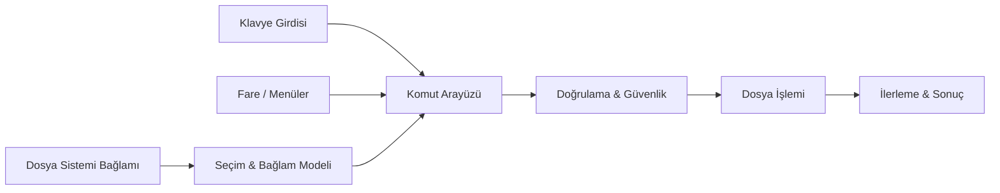

# QuickFile
### Masaüstü için bağlama duyarlı dosya işlemleri

**Masaüstü Üretkenliği** · **Bağlamsal İş Akışları** · **Etkileşim Mühendisliği**

[English](./README.md) · [Deutsch](./README.de.md) · [Türkçe](./README.tr.md)

---

## Genel Bakış

**QuickFile**, dosya ve klasörlerle daha doğrudan etkileşim kurmaya odaklanan bir masaüstü üretkenlik projesidir. Rutin işlemler için birden fazla pencere arasında gezinmek yerine seçilen öğeyi, bağlamını ve o anda gerekli olan eylemleri merkeze alır.

Bağlamsal menülerin keşfedilebilirliğini, klavye odaklı araçların hızını ve kompakt masaüstü arayüzlerini birleştirir. İşletim sisteminin dosya yöneticisinin yerini almak yerine onu tamamlamak üzere tasarlanmıştır.

## Etkileşim Modeli

| Arayüz | Sorumluluk |
|---|---|
| **Bağlamsal eylemler** | Seçili dosya, klasör veya mevcut duruma uygun işlemleri sunmak |
| **Hızlı işlem paneli** | Sık kullanılan işlemlere kompakt erişim sağlamak |
| **Radyal ve iç içe menüler** | İlgili komutları uzun listelere gerek kalmadan düzenlemek |
| **Klavye etkileşimi** | Hızlı gezinme ve komut çalıştırmayı desteklemek |
| **Dosya inceleyici** | Üst verilerle kullanılabilir işlemleri birlikte göstermek |
| **İşlem geri bildirimi** | İlerleme, sonuç, hata ve onay gereksinimini açıklamak |

Farklı giriş yöntemleri aynı eylem semantiğine dayanmalıdır: bir işlemin klavye kısayoluyla veya bağlamsal menüden seçilmesi, işlemin davranışını değiştirmemelidir.

## Kavramsal Mimari

Bu diyagram etkileşim mimarisini gösterir; her bileşenin kodda ayrı bir modül olarak bulunduğunu iddia etmez.

## Mühendislik Yaklaşımı

**Bağlam çözümleme.** Dosya, klasör, çoklu seçim ve işlem sırasında değişebilen dosya sistemi öğelerinde davranışın öngörülebilir olması gerekir.

**Güvenli işlemler.** Silme gibi yıkıcı eylemler açık geri bildirim ve uygun onay gerektirir. Yetki hataları, isim çakışmaları ve yarım kalan işlemler anlaşılır olmalıdır.

**Tepkisellik.** Uzun süren veya asenkron dosya işlemleri arayüzü engellememeli; devam eden, başarılı ve başarısız durumlar ayırt edilebilmelidir.

**Tutarlı etkileşim.** Fare, klavye ve menüler ortak komut modeli, odak yönetimi ve erişilebilir durumlar paylaşmalıdır.

**Masaüstü entegrasyonu.** Dosya sistemi izinleri ve işletim sistemlerine özgü davranışlar açık platform sınırları olarak ele alınmalıdır.

## Tasarım Yaklaşımı

QuickFile; kompakt, bilgi yoğun, sade hareketlere sahip, güçlü görsel hiyerarşili ve belirgin odak durumları sunan masaüstü tasarımını benimser. Görsel kalite, işlevsel akışı destekler.

Projenin temel sorusu şudur: **Kontrolü ve anlaşılırlığı kaybetmeden günlük dosya işlemlerinden kaç adımı kaldırabiliriz?**

---

**QuickFile** · `Desktop Engineering` · `File Workflows` · `Productivity` · `Interaction Design`

Geliştiren: [Taha Kubilay](https://github.com/tahakubilay)

