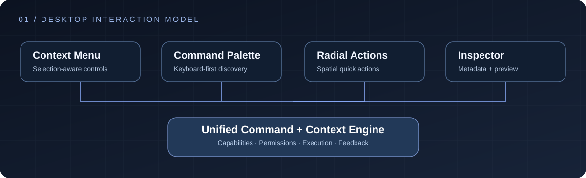
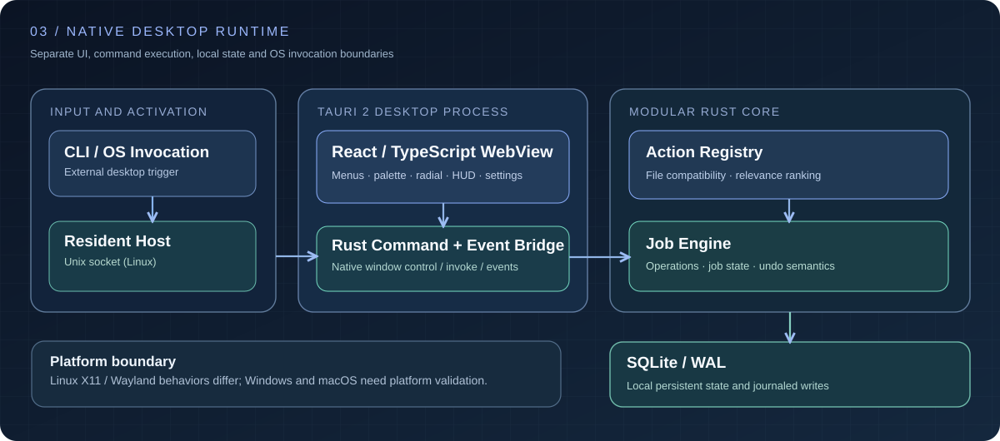
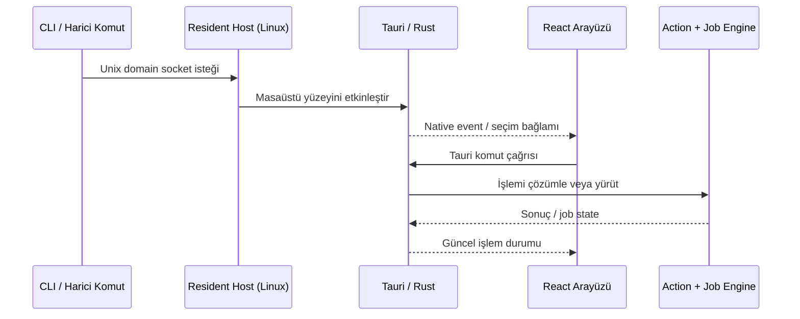
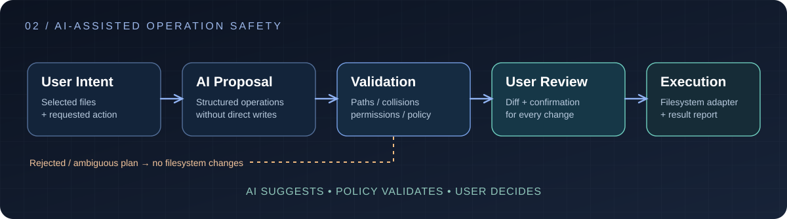
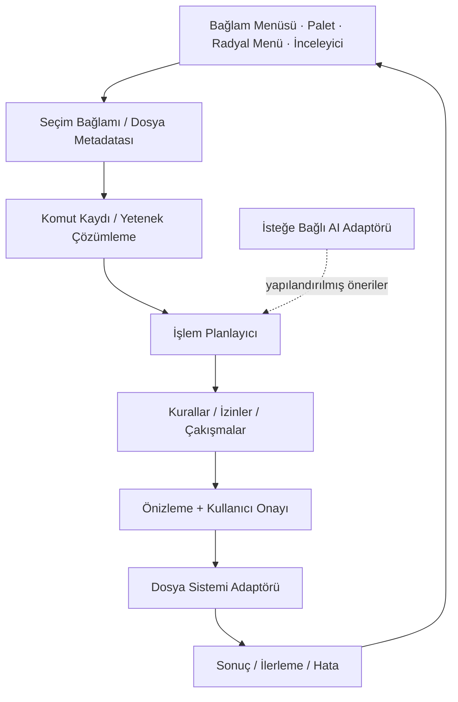

<div align="center">

# QuickFile
### Akıllı dosya işlemleri için bağlama duyarlı masaüstü çalışma alanı


**Bağlamsal Komutlar** · **AI Destekli Dosya İş Akışları** · **Masaüstü Etkileşim Mühendisliği**

[English](./README.md) · [Deutsch](./README.de.md) · [**Türkçe**](./README.tr.md)

</div>

---

## Konsept

**QuickFile**, dosya işlemlerini kullanıcının çalıştığı bağlama yaklaştırır. Dosya sistemi bağlamını, eylem odaklı bir komut yüzeyini ve isteğe bağlı yapay zekâ yardım katmanını tek bir masaüstü iş akışında bir araya getirir.

Klasik dosya yöneticileri gezinmeye, launcher'lar komutlara, AI araçları ise çoğu zaman sohbete odaklanır. QuickFile bu üç yaklaşımın kesişimini ele alır: **öğeyi seç → bağlamını anla → işlemi belirle → önizle → güvenli biçimde uygula**.



## Native Uygulama ve Çalışma Mimarisi

QuickFile, **Tauri 2** masaüstü uygulama altyapısı üzerinde, **React 18 / TypeScript / Vite 6** arayüzü ve modüler **Rust** backend ile geliştirilmiştir. Yalnızca tarayıcı içinde çalışan bir dosya yöneticisi değildir; dosya sistemi komutları, işletim sistemi olayları, yerel süreç koordinasyonu ve kalıcı operasyonel state etrafında şekillenir.

`Tauri 2` · `Rust` · `React 18` · `TypeScript` · `Vite 6` · `SQLite / WAL` · `Unix Domain Sockets (Linux)`



| Çalışma katmanı | Teknik sorumluluk |
|:---|:---|
| **Desktop WebView** | Bağlamsal arayüzler, klavye/fare etkileşimi, önizleme, ilerleme ve ayarlar |
| **Tauri komut köprüsü** | Frontend ile native Rust komutları, pencere kontrolü ve event aktarımı |
| **Rust Action Registry** | Dosya bağlamına göre işlem uygunluğu ve önerilerin sıralanması |
| **Rust Job Engine** | Dosya operasyonları, job state ve işleme göre geri alma (undo) mantığı |
| **SQLite / WAL** | Yerel kalıcı veri ve write-ahead logging |
| **CLI / Resident Host** | Linux'ta Unix domain socket üzerinden çalışan uygulamayı etkinleştirme |

### Masaüstü aktivasyonu ve IPC

Mimarinin temel ayrımlarından biri **kısa ömürlü komut çağrısı** ile **çalışmaya devam eden masaüstü uygulamasını** birbirinden ayırmasıdır. Linux'ta bir CLI komutu Unix domain socket üzerinden resident host'a istek gönderebilir; native katman da ilgili event'i Tauri arayüzüne aktarır. Böylece her harici çağrının yeni bir tam uygulama oturumu başlatması gerekmez.



Diyagram mimari yolu gösterir; pencere odağı, event yönetimi ve işletim sistemine entegrasyon platforma göre farklı davranabilir.

### Uygulamanın somut arayüzleri

Kaynak kodda tek bir genel pencere yerine farklı etkileşim yüzeyleri bulunur:

- **Mini Popup:** seçili dosya veya bağlam için kompakt işlem erişimi.
- **Command Palette:** aranabilir komutlar, klavye ağırlıklı gezinme ve clipboard etkileşimi.
- **Radial / Marking Menu:** sekiz dilimli SVG radial menü; pointer yönü, `1–8` tuşları, yön tuşları, Enter ve Escape etkileşimleri.
- **QuickCompress HUD:** sıkıştırma işlemlerine ayrılmış kompakt işlem arayüzü.
- **AI Explain:** seçili bağlamı veya bir işlemi açıklamaya yönelik ayrı arayüz.
- **Settings:** sunum ve etkileşim tercihleri dahil birden fazla yapılandırma bölümünü içeren geniş ayar yüzeyi.

Native Rust katmanı; sıkıştırma HUD'u, radial menü ve tam boy çalışma alanları için farklı pencere ölçüleri tanımlar. Bu davranış yalnızca CSS responsive ayarı değil, gerçek masaüstü pencere mimarisinin parçasıdır.

### İşlem seçimi, yürütme ve geri alma

Backend'de dosyaya göre **aksiyon filtreleme** (`ActionRegistry::actions_for_files`) ve **öneri sıralama** (`rank_suggestions`) mantığı bulunur. Böylece bir işlemin dosyaya uygunluğu, menüde kaç öğe gösterildiğinden bağımsız olarak modellenebilir. Ayrı Rust job modülü işlemlerin yürütülmesini ve undo ile ilişkili mantığı ele alır.

Undo altyapısının bulunması bütün yıkıcı dosya işlemlerinin kesinlikle geri alınabileceği anlamına gelmez. Kurtarma garantisi, işlem türü ve dosya sistemindeki gerçek sonuca bağlıdır.

### AI arayüzü ile model yeteneklerinin ayrımı

Uygulamada **AI Explain arayüzü ve örnek AI cevapları** bulunur. Bu durum, README'de anlatılan tüm AI senaryolarının uçtan uca gerçek model inference entegrasyonuyla tamamlandığını tek başına kanıtlamaz. Anlamsal arama, içerik özetleme, sınıflandırma ve doğal dille toplu işlem alanları aşağıda **ürün yetenekleri** olarak açıklanır; gerçek davranış için model sağlayıcıları, dosya adaptörleri, doğrulama politikaları ve onay mekanizması gerekir.

### Platform entegrasyonu

Native sistemin öncelikli odağı **Linux masaüstüdür**. **X11 ve Wayland**, özellikle pencere odağı, global pointer hareketi, saydamlık ve compositor davranışlarında farklı sınırlara sahiptir. Projede Windows ve macOS entegrasyonu için de yapılandırma bulunur; ancak bu dosyaların varlığı o platformlarda bütün özelliklerin eşdeğer biçimde doğrulandığı anlamına gelmez.

---

## Etkileşim Yüzeyleri

| Bileşen | Etkileşim | Teknik gereksinim |
|---|---|---|
| **Bağlam menüsü** | Dosya türü ve seçime göre işlem listesi | Filtreleme, kullanılabilirlik, izin denetimi |
| **Hızlı komut paleti** | Büyük pencere açmadan komut arama ve çalıştırma | Klavye odağı, sıralama, kısayollar |
| **Radyal eylemler** | Sık kullanılan işlemlerin mekânsal gruplandırılması | Hedef alanı, iptal, erişilebilirlik |
| **İç içe menüler** | Karmaşık işlemlerin kademeli sunumu | Hiyerarşi, gezinme ve state geçişleri |
| **Dosya inceleyici** | Yol, boyut, zaman damgası, metadata ve işlemler | Asenkron metadata, güncelliğini yitiren seçim |
| **Toplu işlem alanı** | Birden fazla dosyaya ortak eylem uygulama | Çakışma, kısmi başarı, dosya bazlı sonuç |
| **Önizleme ve onay** | Değişiklikleri uygulamadan önce değerlendirme | Güvenlik, değişiklik karşılaştırması |
| **Aktivite / kurtarma** | Devam eden ve biten işlemlerin durumu | İlerleme, iptal, yeniden deneme |

Bütün arayüz yüzeyleri aynı komut mantığını paylaşmalıdır. Aynı işlemin kısayolla veya menüyle başlatılması dosya sistemi davranışını değiştirmemelidir.

### Bağlama göre komut çözümleme

**Yeniden adlandır** komutu farklı seçimlerde farklı kontroller gerektirir:

- Tek bir yazılabilir dosya doğrudan yeniden adlandırılabilir.
- Çoklu seçim için toplu işlem planı ve isim çakışma analizi gerekir.
- Salt okunur klasörlerde yazma komutu geçerliymiş gibi gösterilmemelidir.
- Önizlemeden sonra silinen veya değişen dosyalar işlemden önce tekrar doğrulanmalıdır.
- AI tarafından önerilen adlar geçersiz karakter, ayrılmış isim ve üzerine yazma kurallarını aşamaz.

Arayüz, alttaki **komut sözleşmesinin** bir görünümüdür; dosyaları değiştirme yetkisi vermez.

## Yapay Zekâ Yetenekleri

AI katmanı dosya sisteminde sessizce değişiklik yapan bir otorite değil, **denetlenebilir öneri motoru** olarak ele alınır. Aşağıdaki yetenekler ürünün etkileşim modelinde yer alır; kullanılabilirlikleri dosya adaptörlerine, model yapılandırmasına ve doğrulama mekanizmalarına bağlıdır.

| Yetenek | Kullanım | Güvenlik sınırı |
|---|---|---|
| **Anlamsal dosya arama** | Dosya adını bilmeden içerik veya niyetle arama | Tanımlı indeks kapsamı, gerçek sonuçlar |
| **İçerik özetleme** | Seçilen belge veya dosya grubunu özetleme | Dosya türü, boyut ve gizlilik sınırları |
| **Akıllı isimlendirme** | İçerik ve metadata'ya göre yeni ad önerme | Her eski → yeni yol için önizleme |
| **Otomatik sınıflandırma** | Fatura, görsel, doküman ve proje dosyalarını grupla | Güven seviyesi ve manuel düzeltme |
| **Toplu düzenleme** | Doğal dil isteğini taşıma/kopyalama/adlandırma planına çevirme | Dry-run, çakışma kontrolü ve onay |
| **Metadata çıkarımı** | Yapılandırılmış etiket ve arama özelliği üretme | Veri kökeni ve ayrıştırma hataları |
| **İş akışı önerileri** | Seçim veya tekrar eden örüntü için işlem önerme | Açık kullanıcının kontrolü |

### Örnek: doğal dilden kontrollü dosya işlemine

> "PDF'leri yıllarına göre grupla, hepsine tutarlı isim ver ve orijinal dosyaları koru."

Bu komut doğrudan dosya yazımı değil, **incelenebilir bir işlem planı** oluşturmalıdır: algılanan yıl, hedef klasör, mevcut yol, önerilen yeni yol, belirsizlik ve kopyalama/taşıma semantiği. Kullanıcı onayı olmadan değişiklik yapılmaz. Okunamayan dosyalar, belirsiz tarihler ve çakışmalar açıkça gösterilir.



**Gizlilik sınırı:** Yerel metadata işleme ile uzak bir AI servisine dosya gönderimi aynı işlem değildir. Güvenli mimari; yerel işlemeyi, isteğe bağlı uzak model adaptörlerini ve açık kullanıcı onayını ayırmalıdır. AI komutu seçmek, belgenin içeriğini harici servise aktarmaya otomatik izin vermez.

## Teknik Mimari



Diyagram ürünün **mimari sınırlarını** gösterir; her adaptörün yayımlanmış kod olarak bulunduğu anlamına gelmez.

### Komut sözleşmesi örneği

```ts
type FileActionPlan = {
  operation: "copy" | "move" | "rename" | "delete";
  targets: Array<{
    source: string;
    destination?: string;
    expectedFingerprint?: string;
  }>;
  preconditions: string[];
  collisions: Array<{ path: string; reason: string }>;
  confirmationRequired: boolean;
};
```

Bu, yayımlanmış bir SDK arayüzü değil, **açıklayıcı bir modeldir**. AI veya UI'dan gelen öneri ile doğrulanmış dosya işlemi birbirinden ayrılır.

## Dayanıklılık ve Hata Senaryoları

| Risk | Teknik yaklaşım |
|---|---|
| **Time-of-check / time-of-use** | Seçimi ve hedefi yürütme anında tekrar doğrula |
| **İsim çakışmaları** | Atla, yeniden adlandır, açık onayla üzerine yaz gibi deterministik kurallar |
| **Kısmi toplu işlem** | Tüm grubu atomikmiş gibi sunma; dosya bazında sonuç sakla |
| **İptal** | Kesilebilir işlemleri ve geri alma sınırlarını ayır |
| **İzin / kilit hataları** | Başarılıymış gibi göstermeden gerçek hata raporla |
| **Yol / bağlantı güvenliği** | Sembolik link, path traversal ve korunan dizinleri denetle |
| **Güvenilmeyen AI çıktısı** | Yapılandırılmış komutu ayrıştır, izinli işlemleri doğrula, onay iste |
| **Uzun işlemler** | Arayüzü bloklamadan ilerleme durumunu yansıt |

Geri alma garantisi işlem türüne bağlıdır: bir isim değişikliğini geri almakla kalıcı silinmiş bir dosyayı kurtarmak aynı şey değildir.

## Masaüstü Tasarım Sistemi

QuickFile kompakt bilgi yoğunluğu, net görsel hiyerarşi ve ölçülü animasyon yaklaşımıyla tasarlanır. Seçim, hover, klavye odağı, pasif, işlemde, yıkıcı ve başarılı durumlar yalnız renk farkıyla değil etkileşim kurallarıyla tanımlanır.

Arayüz sistemi; işlem satırları, komut arama, radyal/iç içe menüler, kısayol ipuçları, dosya inceleyici, önizleme, onay modalları, ilerleme göstergeleri ve aktivite bildirimlerinden oluşan bileşenler etrafında şekillenir.

**Proje bağlamı:** QuickFile açık kaynak odaklı bir masaüstü ürünüdür. Bu repo etkileşim ve mühendislik modelini sunar; diyagramlar veya örnek tipler bütün yeteneklerin çalışır biçimde yayınlandığına dair kanıt değildir.

---

<div align="center">

Geliştiren: [Taha Kubilay](https://github.com/tahakubilay) · [English](./README.md) · [Deutsch](./README.de.md)

</div>
